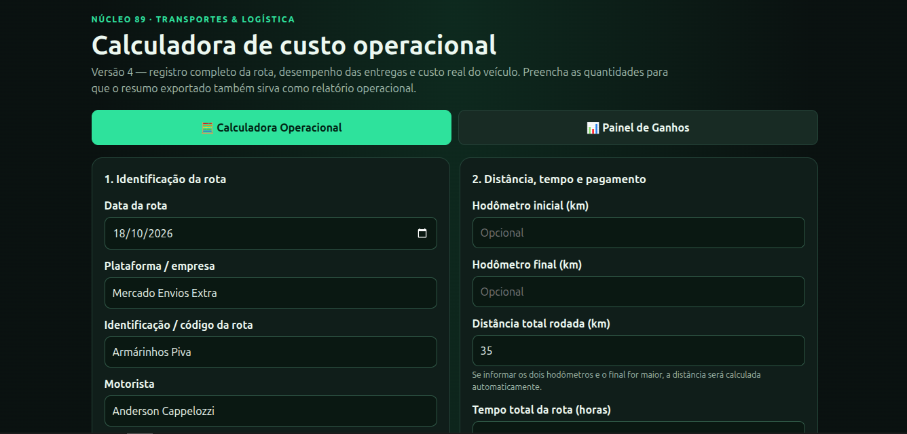
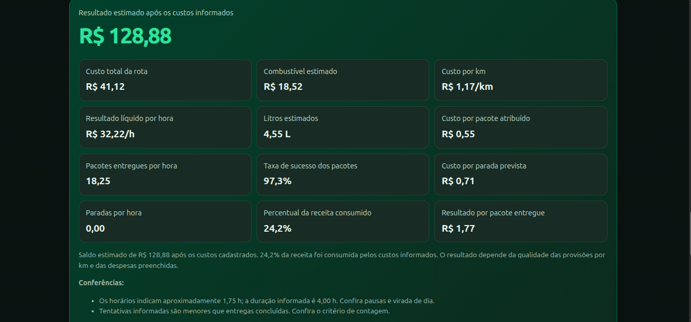

# NÚCLEO 89 — Calculadora Operacional de Rotas

**Tecnologia prática para quem vive a estrada.**

## 📸 Conheça a calculadora

A interface reúne o preenchimento dos dados operacionais da rota e o Painel de Ganhos, facilitando o acompanhamento de custos, produtividade e resultados.

Uma ferramenta gratuita para entregadores que querem entender melhor os custos, acompanhar a produtividade e descobrir quanto realmente sobra depois das despesas de cada rota.

[**Acessar o projeto no GitHub**](https://github.com/nucleo-89/nucleo89-calculadora-rotas)

---

## 🚚 O que é o NÚCLEO 89 Calculadora Operacional de Rotas?

O NÚCLEO 89 — Calculadora Operacional de Rotas é uma ferramenta desenvolvida para ajudar profissionais de entrega a analisar o resultado do próprio trabalho.

Uma rota pode parecer lucrativa pelo valor recebido, mas combustível, manutenção, pneus, depreciação do veículo, alimentação e outras despesas também precisam entrar na conta.

A calculadora reúne essas informações em um só lugar para facilitar a análise de custos, ganhos e produtividade.

**O projeto nasceu da experiência prática com entregas e da ideia de tornar ferramentas de análise operacional mais acessíveis a quem vive a rotina das ruas.**

## 🎯 Para quem é?

- Entregadores autônomos.
- Motoristas que trabalham com carro ou outro veículo.
- Profissionais de logística e distribuição.
- Entregadores que trabalham com diferentes plataformas e empresas.
- Pessoas interessadas em acompanhar custos, produtividade e rentabilidade.

A ferramenta foi pensada para ser útil independentemente da plataforma de entrega utilizada. Os resultados dependem das informações preenchidas pelo próprio usuário.

## ⚙️ O que a ferramenta oferece?

### Calculadora de rota

- Identificação da data, plataforma, veículo e rota.
- Registro de quilometragem e tempo de trabalho.
- Registro da remuneração bruta, bônus e despesas adicionais.
- Estimativa do combustível consumido durante o deslocamento e com o motor em marcha lenta.
- Provisões editáveis para manutenção, pneus, depreciação e outros custos.
- Registro de pacotes, paradas, entregas concluídas, insucessos, devoluções e ocorrências.
- Geração de relatórios operacionais.

### Painel de Ganhos

- Histórico das rotas salvas.
- Resumo da receita bruta, dos custos registrados e do saldo após custos.
- Acompanhamento da distância percorrida e das horas trabalhadas.
- Indicadores de ganho líquido por hora e combustível estimado.
- Total de pacotes entregues.
- Filtros por dia, últimos sete dias, mês ou histórico completo.
- Exportação e importação de backup do histórico.

## 🟢 Como começar

Você não precisa saber programar, instalar um servidor ou configurar um banco de dados.

### 1. Baixe a calculadora

1. Acesse o [repositório oficial no GitHub](https://github.com/nucleo-89/nucleo89-calculadora-rotas).
2. Abra o arquivo da calculadora na pasta `nucleo89_calculadora_painel_ganhos_v4`.
3. Na página do arquivo, clique em **Raw** ou em **Download raw file**, quando disponível, para obter o arquivo.
4. Ou [Baixe o arquivo diretamente](https://github.com/nucleo-89/nucleo89-calculadora-rotas/releases/download/4.0/nucleo89_calculadora_painel_ganhos_abas_v4_nova_rota.html)

### 2. Abra no navegador

Salve o arquivo no seu computador e abra-o com um navegador moderno, como Chrome, Firefox ou Edge.

Se o arquivo for baixado sem a extensão `.html`, renomeie-o para terminar em `.html` antes de abri-lo.

A calculadora foi desenvolvida em HTML, CSS e JavaScript e funciona localmente no navegador, sem exigir um servidor para realizar os cálculos.

### 3. Preencha os dados da rota

Comece informando os dados que você conhece:

- Distância total percorrida.
- Tempo total da rota.
- Valor recebido.
- Preço do combustível e consumo médio do veículo.
- Entregas realizadas e ocorrências.
- Despesas variáveis e custos fixos que deseja atribuir à rota.

Revise os valores sugeridos nos campos antes de utilizar os resultados. Os custos por quilômetro e as demais estimativas devem refletir a sua realidade.

### 4. Analise o resultado e salve a rota

Consulte os indicadores e o relatório operacional. Quando terminar, utilize a opção **Salvar rota no painel** para registrar os dados no histórico local.

Abra a aba **Painel de Ganhos** para acompanhar o conjunto das rotas que você salvou.

## 💾 Privacidade e backup

A calculadora foi projetada para funcionar localmente. Os registros são armazenados no armazenamento local do navegador e não são enviados a um servidor pelo funcionamento normal da aplicação.

**Atenção:** o histórico fica associado ao navegador e ao aparelho utilizados. Ele pode não estar disponível em outro navegador ou dispositivo e pode ser perdido se os dados locais forem apagados.

Para reduzir o risco de perda:

1. Abra o Painel de Ganhos.
2. Clique em **Exportar backup**.
3. Guarde o arquivo JSON em um local seguro.
4. Faça novos backups periodicamente.
5. Para recuperar os dados, use **Importar backup**.

Não compartilhe arquivos de backup sem verificar o conteúdo, pois eles podem conter informações pessoais e detalhes das suas rotas.

## 📊 Como interpretar os resultados

A calculadora ajuda a organizar os números, mas a qualidade da análise depende dos dados informados.

- **Receita bruta:** remuneração e adicionais registrados para a rota.
- **Custos registrados:** despesas e provisões consideradas nos cálculos.
- **Saldo após custos:** resultado calculado depois de descontar os custos considerados.
- **Ganho líquido por hora:** indicador que relaciona o saldo calculado ao tempo de trabalho informado.

Combustível, manutenção, desgaste do veículo e despesas de trabalho precisam ser considerados com atenção. Evite lançar a mesma despesa duas vezes.

O saldo apresentado não representa necessariamente o lucro contábil definitivo nem substitui o cálculo de obrigações fiscais, previdenciárias ou outras despesas que não tenham sido informadas.

## 🤝 Como colaborar

O NÚCLEO 89 é um projeto aberto a sugestões, testes e contribuições que possam torná-lo mais útil para quem trabalha com entregas.

Você pode colaborar de diferentes formas:

- Testando a calculadora com dados fictícios ou devidamente anonimizados.
- Relatando erros ou resultados inesperados.
- Sugerindo melhorias na experiência de uso.
- Propondo novos indicadores e funcionalidades.
- Contribuindo com documentação e melhorias no código.

Para registrar uma sugestão ou um problema, acesse a seção [Issues do projeto](https://github.com/nucleo-89/nucleo89-calculadora-rotas/issues).

Ao relatar um problema, descreva o que você tentou fazer, o que esperava que acontecesse e o que aconteceu de fato. Não publique dados pessoais, informações de clientes ou endereços de entrega.

## 📜 Licença

O código do projeto está disponibilizado sob a licença MIT. Consulte o arquivo [LICENSE](https://github.com/nucleo-89/nucleo89-calculadora-rotas/blob/main/LICENSE) para conhecer os termos aplicáveis.

O uso do código sob essa licença não deve ser confundido com uma autorização irrestrita para utilizar a identidade visual, o nome ou o logotipo da NÚCLEO 89 como se fossem de sua propriedade.

## ⚠️ Aviso importante

Esta ferramenta é destinada à organização e à análise operacional. Os resultados são estimativas baseadas nos dados fornecidos pelo usuário.

Ela não substitui orientação contábil, fiscal, financeira ou jurídica profissional, nem garante a rentabilidade de uma rota.

## 📲 Como instalar a NÚCLEO 89

A **NÚCLEO 89 — Calculadora de Rotas** também está disponível como PWA (*Progressive Web App*), permitindo instalar o aplicativo em dispositivos compatíveis sem precisar baixar um APK ou instalador tradicional.

🔗 **Acesse a versão oficial:**

https://nucleo-89.github.io/nucleo89-calculadora-rotas/

### 🤖 Android

Recomendamos utilizar o Google Chrome atualizado.

1. Abra o Google Chrome no celular.
2. Acesse https://nucleo-89.github.io/nucleo89-calculadora-rotas/
3. Aguarde a calculadora carregar.
4. Toque no menu de três pontos (⋮), no canto superior direito.
5. Procure a opção **Instalar app** ou **Adicionar à tela inicial**.
6. Se aparecer uma opção para instalar o aplicativo, selecione-a e confirme.
7. Aguarde a instalação. O ícone da NÚCLEO 89 ficará disponível na tela inicial ou na lista de aplicativos.

**Se a opção de instalação não aparecer:** verifique se está utilizando um navegador compatível e atualizado. Dependendo da versão do navegador e do dispositivo, o procedimento pode variar.

### 💻 Windows

Recomendamos o Google Chrome ou o Microsoft Edge.

**Google Chrome**

1. Abra o Chrome e acesse a versão oficial da NÚCLEO 89.
2. Procure o ícone de instalação na barra de endereço. Se ele não aparecer, abra o menu de três pontos.
3. Entre em **Transmitir, salvar e compartilhar**.
4. Selecione **Instalar esta página como um app…**.
5. Confirme a instalação.

**Microsoft Edge**

1. Abra o Edge e acesse a versão oficial.
2. Abra o menu de três pontos.
3. Procure **Aplicativos** e depois a opção para instalar o site como aplicativo. Os nomes podem variar conforme a versão.
4. Confirme a instalação.

Depois disso, abra a NÚCLEO 89 pelo menu Iniciar, pela lista de aplicativos ou pelo atalho criado pelo navegador.

### 🐧 Linux

Em distribuições como Ubuntu, Linux Mint e Debian, é possível instalar a PWA usando um navegador compatível, como Google Chrome ou Microsoft Edge.

1. Abra o navegador.
2. Acesse a versão oficial da NÚCLEO 89.
3. Procure o ícone de instalação na barra de endereço ou a opção de instalação no menu do navegador.
4. Confirme a instalação.

Após instalada, a calculadora poderá ser aberta pela lista de aplicativos ou pelo atalho criado pelo navegador.

### 🍎 macOS

No macOS, a disponibilidade e o procedimento dependem do navegador utilizado.

- **Google Chrome:** acesse o site e procure a opção de instalar a página como aplicativo.
- **Safari:** nas versões compatíveis, procure a opção **Adicionar ao Dock** no menu Arquivo ou Compartilhar.

Siga as instruções exibidas pelo navegador para concluir o processo.

### 🌐 Posso usar sem instalar?

Sim. Basta abrir o endereço oficial no navegador:

https://nucleo-89.github.io/nucleo89-calculadora-rotas/

A instalação é opcional e serve para facilitar o acesso à calculadora.

### 📴 Funcionamento offline

A PWA possui um mecanismo de cache para armazenar recursos do aplicativo e permitir acesso offline em condições compatíveis.

**Importante:** o funcionamento offline pode depender de o aplicativo já ter sido carregado anteriormente e dos recursos disponíveis no cache. Algumas funções podem precisar de conexão com a internet.

### 💾 Histórico e backups

O armazenamento das rotas permanece associado ao navegador e à origem utilizada. Instalar a PWA não significa que o histórico será automaticamente sincronizado entre dispositivos.

Para evitar perder os registros, utilize os recursos de exportação e importação de backup disponibilizados pela calculadora, quando disponíveis.

Recomendamos guardar cópias de segurança em um local seguro antes de trocar de dispositivo, limpar os dados do navegador ou reinstalar o aplicativo.

### 🔄 Atualizações

A NÚCLEO 89 é distribuída pela web. Quando uma nova versão for publicada, o navegador poderá atualizar os recursos armazenados em cache.

Se uma atualização não aparecer imediatamente:

1. Feche o aplicativo.
2. Abra-o novamente com conexão à internet.
3. Se necessário, acesse a versão oficial pelo navegador e atualize a página.

Evite limpar os dados do navegador ou do aplicativo sem antes exportar e guardar seus backups.

### 🔒 Privacidade e uso

A NÚCLEO 89 foi desenvolvida para auxiliar entregadores no cálculo e na análise de suas rotas.

A instalação não exige baixar um APK de terceiros. Utilize sempre o endereço oficial do projeto e tenha cuidado com cópias ou páginas que se apresentem como versões oficiais sem autorização.

## 🛣️ Sobre a NÚCLEO 89

A NÚCLEO 89 desenvolve soluções tecnológicas práticas para problemas reais da rotina operacional.

**NÚCLEO 89 — Tecnologia prática para quem vive a estrada.**

[Repositório oficial](https://github.com/nucleo-89/nucleo89-calculadora-rotas) · [Reportar um problema](https://github.com/nucleo-89/nucleo89-calculadora-rotas/issues)
